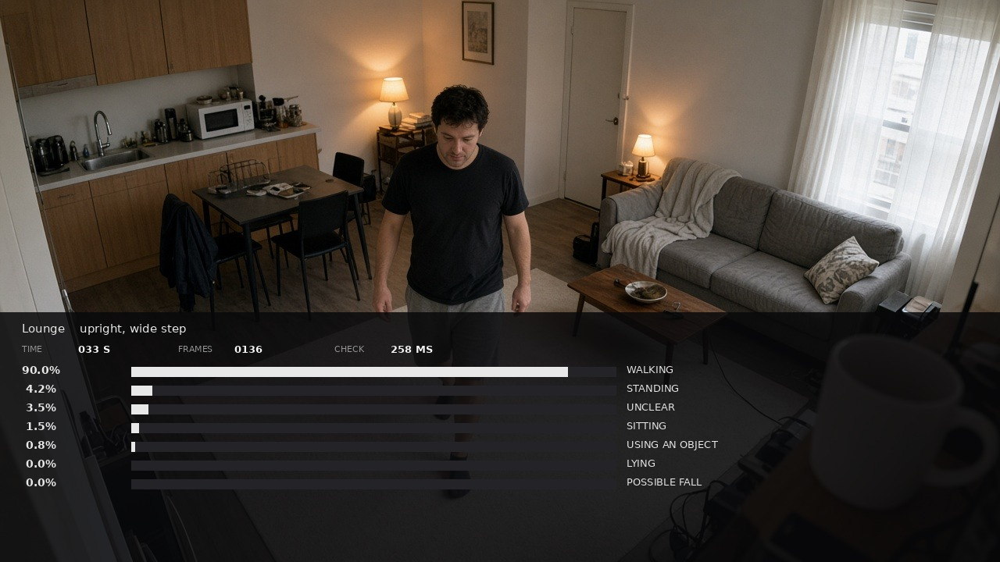
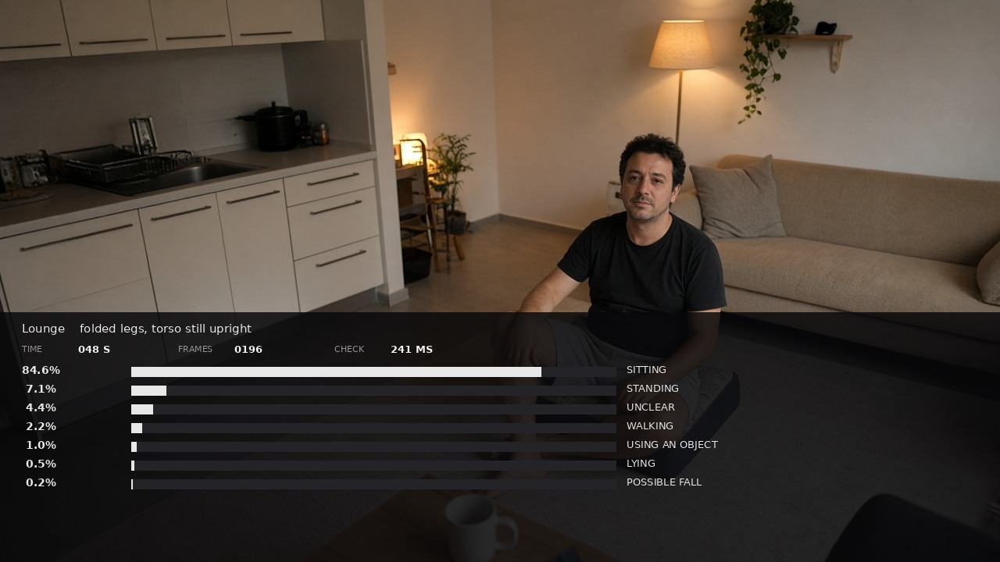
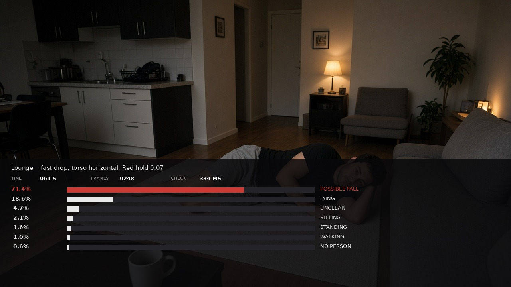
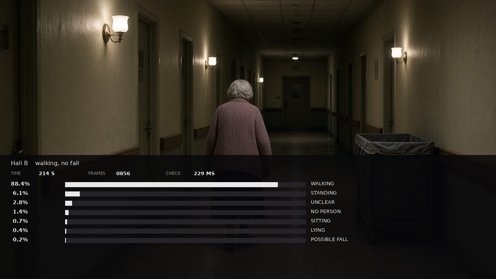

# Hearth

Hearth reads a room camera and keeps eight live scores: standing, walking, sitting, using an object, unclear, nobody visible, lying, and possible fall. The scores sum to 1 and are sorted with the highest on top. They ease up and down, so a held posture climbs and a sudden change trades the lead.

If possible fall stays on top, the state is `red_hold` for 10 seconds, then `asking` for 20 seconds. Standing or walking cancels it. Each change is a short JSON message with the room name and the scores. There is no image in the message. A robot or a staff tablet can subscribe to that message. The camera side is the one that sends it.

## Model

The body points come from RTMPose through [rtmlib](https://github.com/Tau-J/rtmlib), mode `performance`. On the COCO single-person table in the RTMPose paper, RTMPose-m is 82.4 AP and RTMPose-l is 83.5 AP, against 35.4 AP for BlazePose-Full, with the same detector family in that table (arXiv:2303.07399). YOLOv11n-pose is 50.0 pose AP on COCO val, and current Ultralytics pose weights are AGPL-3.0, so they are not the default here. RTMPose weights from OpenMMLab are Apache-2.0.

The eight scores are geometric: torso angle, how fast the hips drop, step width, knee bend, and wrist reach. Possible fall uses the fastest drop inside a 2 second window, and only if the torso also left upright. A crouch that stays upright does not raise it. Two seconds is the window length that beat 1 second and 3 seconds for an ST-GCN fall model on UP-Fall inertial clips (Sensors, 2023). A trained fall network is not shipped. Papers on UR Fall, UP-Fall, and Le2i often report accuracy in the mid or high 90s on staged clips. A public RTMPose plus ST-GCN++ check was about 87% on the set it trained on and about 62% on a set it had not seen. Those staged numbers are not a promise for a care floor. The geometric ranker is what you can run and test before any of your own clips exist.

## Screens

Four views of the finished product. The rooms are ordinary. The type is drawn on top so the numbers stay sharp.

Walking leads in a lounge:



Sitting takes the top bar:



A fast drop holds the red bar:



Walking leads in the hall, with the same bars:



## Run

Requires Python 3.11 or newer.

```bash
python3.12 -m venv .venv
source .venv/bin/activate
pip install -e ".[pose,dev]"
pytest
python -m hearth --video clip.mp4 --room lounge
```

The first video run downloads the pose weights. `pytest` does not download them and does not need a camera. Pass `--mode balanced` for a smaller pose model, or `--device cuda` when a GPU is available.

One JSON object is printed per sample, about 4 per second:

```json
{"t": 1.25, "leader": "standing", "state": "watching", "ranked": [["standing", 0.81], ["walking", 0.07]]}
```

A state change adds a `message` object. `red_hold` and `asking` are the events worth acting on. `escalate` means the spoken check was not answered.

## Not in this version

Night-time counts, bed exit, and a robot driving to a doorway are not in this repository yet. The message is the hook for them. Bedroom and bathroom cameras are out of scope.
